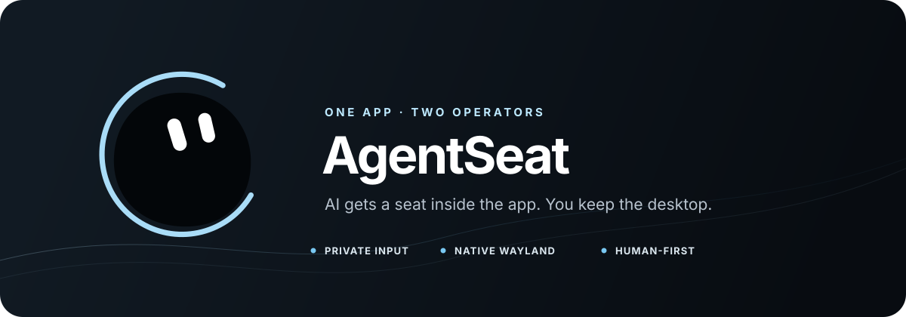

<p align="center">
  
</p>

<p align="center">
  <a href="README.md">English</a> · <strong>简体中文</strong>
</p>

<h1 align="center">AgentSeat</h1>

<p align="center">
  <strong>在一个本地应用里，为 AI Agent 提供独立操作席位。</strong><br>
  Agent 有自己的指针和键盘，你的仍然属于你。
</p>

<p align="center">
  <a href="https://github.com/vimalinx/AgentSeat/releases/latest"></a>
  <a href="LICENSE"></a>
  <a href="https://linux.do/"></a>
  
  
</p>

AgentSeat 让人类和 AI Agent 同时操作同一个普通 GUI 应用。它围绕
Agent 的虚拟输入和观察能力建立了一条狭窄的应用边界，而不是在用户外面
再套一个桌面。

| 人类保留 | Agent 获得 | 边界保证 |
| --- | --- | --- |
| 真实指针和键盘 | 私有虚拟指针和键盘 | 不移动宿主指针 |
| 宿主焦点和工作区 | 应用范围内的焦点 | 不切换工作区 |
| 正常复制粘贴 | 私有 Unicode 粘贴 | Agent 输入不替换人工复制的内容 |

## 生来轻量

运行时刻意保持精简：

- 宿主上只有一个由 Hyprland 正常平铺布局管理的普通窗口；
- 一个精简的单应用 wlroots 微宿主；
- 一个负责观察和限定范围输入的原生事件循环守护进程；
- 没有嵌套 Hyprland、桌面环境、虚拟机、tmux 或逐应用驱动；
- 无须修改 Hyprland 或其配置。

默认运行原生 Wayland 应用，私有 XWayland 通道用于兼容旧版 X11 软件。
对话框和子窗口会留在同一棵私有应用树中。主表面铺满 Hyprland 分配的平铺
区域；对话框保留应用请求的尺寸，只有超过可用区域时才会被约束。显式启用后，
小型协作脑袋也渲染在这棵树内部，而不是成为全局桌面浮层。

> AgentSeat 隔离的是输入和焦点，不是文件系统、进程或网络沙箱；被封装
> 的程序仍以你的本地用户身份运行。

## 开发版控制协议

当前源码实现[控制协议 v2](docs/PROTOCOL.md)，包括有界非阻塞连接、会话写入校验、
单写入者租约、有界去重回执、可取消文本、长按截止和合成器人类接管门禁。
窗口与几何直接读取微宿主，截图一次完成。可选 `--a11y` 提供范围内的控件读取、
原生语义动作、事件与条件核验，可通过 CLI 或薄 Python SDK 使用；
`--ime auto` 默认保留用户的输入法模块及优先顺序、语言和 Compose 配置。
标准 Wayland text-input-v3 透传给父合成器；已选用的 Fcitx、IBus 保留原服务连接。
用户键盘的布局、修饰键组和重复参数独立于 Agent 键盘。
`--ime fcitx5` 使用用户配置的独立副本；`--ime simple` 关闭输入法集成。
人工复制粘贴通过正常窗口协议双向传递文字、图片及 HTML，Agent 的粘贴仍保持私有。自动化调用应持续使用同一个、与其他 Agent
不同的 `--controller <身份>`。控制器、daemon 和微宿主需要配套构建。
输入提交回执仍需通过应用观察验证实际效果；完整 vNext 的进展与待办见
[实施计划](docs/IMPLEMENTATION_PLAN.md)。

## 按控件含义操作

以 `--a11y` 启动应用，读取实际控件，再执行动作并核对结果。

```sh
agentseat --instance editor run --a11y -- /usr/bin/mousepad --disable-server
agentseat --instance editor a11y query Save --exact --role button
agentseat --instance editor a11y get '<node_ref>'
agentseat --instance editor --controller writer a11y perform '<node_ref>' 0
agentseat paths
```

`paths` 返回已安装的 `python_sdk` 路径，用于复用“查找 → 操作 → 等待”的闭环。
[协议文档](docs/PROTOCOL.md#events-conditions-and-python-client)包含 SDK、受限子树查询和
后置条件示例。GTK、Qt 测试应用与真实 Mousepad 的保存任务已验收。具体控件能力由应用
决定，缺少语义能力时使用视觉输入；已发出的应用调用无法靠暂停撤回，未知结果不会自动重试。

微信 4.1.1.8 已在 XWayland 通道用现有账号验证登录、导航、搜索、私有 Unicode 粘贴和
私有拼音输入。只提供获取焦点动作的按钮需使用视觉点击；部分内嵌无障碍子树仍不完整，
应缩小到所需控件子树并检查返回结果。通用桥接逐项读取已知属性，X11 弹窗隐藏后
再请求调整尺寸也不会访问已销毁的画面节点。

## 系统要求

当前版本面向以 Hyprland 为宿主的 Linux，需要：

- C17 编译器、CMake、Meson、Ninja 和 GNU gettext 工具；
- wlroots 0.20、Wayland、Wayland protocols 和 libxkbcommon；
- json-c、libpng、GLib/GIO、GTK 4、gtk4-layer-shell、ATK 和 libdbus 开发文件；
- 剪贴板验收探针可选用 `wl-clipboard`；原生粘贴不依赖辅助进程；
- 控制器需要 Python 3.11 或更高版本；
- `--x11` 或 `--ime fcitx5` 需要 XWayland；
- 可选无障碍功能需要 Python GObject/Gio、D-Bus 和 AT-SPI2；
- 输入法集成需要 Fcitx5、已配置的输入引擎，以及兼容的工具包模块或 XIM 接口。

在 Arch Linux 上，对应的软件包包括 `base-devel`、`cmake`、`meson`、
`ninja`、`wlroots0.20`、`wayland`、`wayland-protocols`、`libxkbcommon`、
`json-c`、`libpng`、`gtk4`、`gtk4-layer-shell` 和 `gettext`。

## 构建与安装

在本目录执行：

```sh
./scripts/build.sh
./bin/agentseat version
```

构建产物保留在 `build/` 下，并在 `bin/` 中生成三个被 Git 忽略的可执行
文件。安装到当前用户：

```sh
./scripts/install.sh
~/.local/bin/agentseat version
```

安装后的版本位于
`${XDG_DATA_HOME:-~/.local/share}/agentseat/releases`；`current` 选择当前版本，
`${XDG_BIN_HOME:-~/.local/bin}/agentseat` 只指向安装副本，不再指向开发仓库。

安装器校验发布文件后原子切换 `current`，保留旧版本，不重启已有应用。
需要回滚时运行 `./scripts/install.sh --rollback <发布摘要>`，新启动的应用会使用
所选版本。

## 使用方法

```sh
agentseat run --host-workspace 8 -- /usr/bin/zenity --info --text='你好'
agentseat run --private-dbus -- /usr/bin/example-single-instance-app
agentseat status
agentseat heartbeat
agentseat watch --interval 5
agentseat windows
agentseat move 0.50 0.50
agentseat click
agentseat type '来自 Agent 的问候'
agentseat scroll vertical -120
agentseat observe
agentseat wait-change --since SERIAL --timeout-ms 5000
agentseat doctor
agentseat capabilities
agentseat pause
agentseat resume
agentseat stop
```

基本闭环是 `observe → 操作 → wait-change → observe`。`observe` 返回 `content_serial`，
把它传给 `wait-change --since`，截图之后发生的变化就不会漏掉。光标闪烁、指针移动和
协作脑袋不算变化。`doctor` 只诊断依赖、范围和坐标映射，不做任何修改；`capabilities`
区分已实现、应用暴露、本会话授权和当前可用的能力。

`run` 保留原来的单一默认会话，适合 Agent 直接操作。需要让每个桌面应用拥有
独立可管理的 AgentSeat 实例时，使用 `launch`：

```sh
agentseat launch -- /usr/bin/mousepad
agentseat launch --x11 -- /usr/bin/example-x11-app
agentseat instances
agentseat --instance mousepad-a1b2c3d4 observe /tmp/mousepad.png
agentseat --instance mousepad-a1b2c3d4 stop
```

`launch` 会分配私有运行时和状态命名空间，默认把外层窗口放到当前宿主工作区。
传入 `--host-workspace N` 可以放到其他工作区而不切换人类工作区。实例标识会
出现在返回结果的 `state.instance` 中，也可以随时通过 `instances` 找回。

`run` 直接接收 argv，绝不会交给 shell 求值。默认使用 Wayland；需要通用
私有 XWayland 通道时使用 `run --x11 -- COMMAND ...`。应用必须由 AgentSeat
启动；Wayland 合成器边界不允许把已经运行的宿主窗口直接搬进来。

未传入 `--cwd` 时，应用继承调用 `agentseat` 时的当前目录。命名实例默认只
隔离 AgentSeat 自己的运行时和状态；对于通过会话 D-Bus 实现单实例的应用，
可以增加 `--private-dbus`。应用自己的配置目录、账号和文件仍由调用者决定，
AgentSeat 不会擅自改写 `HOME` 或应用 profile。

只应让独立的用户应用经过 `launch`。壁纸进程、Polkit Agent、托盘程序、
桌面 Portal、输入法和空闲守护进程等宿主会话基础设施必须继续连接宿主
Hyprland。AgentSeat 提供多实例启动边界，但不会静默改写 Hyprland 快捷键
或桌面条目。

每条控制器命令都会重新连接常驻守护进程。每个会话都有稳定的随机身份，
`status` 和 `heartbeat` 都会返回它。`watch` 会固定这个身份，并在每次重连时
输出一行 JSON 心跳；如果会话被替换，它会直接失败，不会悄悄接管新会话。
另一个 Agent 进程接手应用时，可以显式传入身份：

```sh
agentseat heartbeat --expect-session ID
agentseat watch --expect-session ID --interval 5 --count 12
```

`--count 0` 是默认值，表示持续监测到进程被中断。监测是只读的：不会聚焦、
重启应用或注入输入。控制器或 `watch` 退出后，GUI 和私有 seat 仍可常驻，
后续 Agent 可以重新连接。AgentSeat 提供的是这个持续的操作席位；真正长期
自主执行任务仍需要外部的 Agent 调度器或循环。

指针坐标采用从 `0.0` 到 `1.0` 的归一化值。当前 XKB 键盘映射能够表达的
文本通过虚拟键盘事件输入；其他 Unicode 文本使用私有微宿主内的有界剪贴板，
支持重复读取，直到控制权撤销或十秒到期。它既不读取也不替换宿主剪贴板。
粘贴回执只确认数据传输，释放控制权前仍需核对应用中的实际文字。
协议见 [PROTOCOL.md](docs/PROTOCOL.md) 的 `keyboard.paste`。

编辑文字时，`a11y text-state <node_ref>` 可读取应用中的光标与选区范围。
先确认这些状态再发送依赖它们的复制或编辑快捷键，随后核对实际文字或保存文件。
启动应用会等待已聚焦的普通窗口，不强制聚焦启动画面。
Agent 拖动期间，暂停、释放控制、按住超时和人类接管会先取消拖放数据源，再释放鼠标键。
已经完成的放置不能靠暂停撤回；来自物理指针或触摸的拖动保留其控制归属。

目标工作区默认为 1。目标是非活动工作区时，AgentSeat 会使用一次性的
Hyprland 窗口放置规则并抑制焦点，不切换人类所在的工作区。外层窗口仍是
普通窗口，人类可以主动选择聚焦它。

协作小脑袋默认隐藏。在 `~/.config/agentseat/config.toml` 中设置
`eye_hud = true` 可以让它自动出现，也可以为当前 AgentSeat 会话执行
`agentseat hud start`。观察、虚拟输入和焦点隔离都不依赖小脑袋。

协作脑袋拖动后会自动按程序保存位置，配置位于 `~/.config/agentseat/applications/`。
同一程序下次打开（包括不同名称的实例）会恢复位置，不同程序互不影响；窗口缩放后仍限制在可见范围内。
X11 弹窗和菜单保留程序请求的位置，Wayland 弹出菜单继续使用原生定位规则。

关闭桌面窗口会向程序发送普通关闭请求，由程序决定取消、退出还是留在后台。
最后一个程序窗口消失时，桌面的外层窗口也会消失；常驻程序仍可使用私有显示服务，
程序再次显示窗口时会正常出现。没有窗口时，`heartbeat` 返回健康的 `background`
会话和 `window_ready: false`。程序正常退出时，不额外结束它主动留下的无界面工作；
`agentseat stop` 仍表示明确结束整个受管理会话。

## 语言

AgentSeat 默认跟随系统语言，目前提供完整的英文、简体中文和繁体中文
界面。持久设置写入 `~/.config/agentseat/config.toml`：

```toml
[general]
language = "zh-CN" # auto、en、zh-CN 或 zh-TW
```

单次命令可以使用 `agentseat --language zh-TW --help`，一个进程树可以设置
`AGENTSEAT_LANGUAGE`。优先级依次是命令行覆盖、环境变量覆盖、配置文件、
系统 locale。不支持的语言回退到英文。不同语言下的 JSON 字段名、枚举值、
RPC 方法和错误码始终保持稳定。

## 数据与隐私

正常运行期间，源码和安装目录保持只读。执行 `agentseat paths` 可以查看
实际生效的 XDG 路径：

```text
~/.config/agentseat/config.toml   可选的用户配置
~/.local/share/agentseat/         持久应用数据
~/.local/state/agentseat/logs/    私有日志
~/.local/state/agentseat/captures 显式观察生成的图像
~/.local/state/agentseat/apps/    具名实例的日志与截图
~/.cache/agentseat/               可随时丢弃的缓存
$XDG_RUNTIME_DIR/agentseat/       套接字、PID 文件和当前状态
$XDG_RUNTIME_DIR/agentseat-apps/  具名应用实例的运行时
```

聊天消息只存在于内存，守护进程退出后即消失。只有显式执行 `observe` 才会
写入截图。目录权限为 0700，私有文件权限为 0600。详见
[docs/DATA_LAYOUT.md](docs/DATA_LAYOUT.md)。

无须修改安装目录即可自定义默认值：

```sh
mkdir -p ~/.config/agentseat
cp config/config.toml.example ~/.config/agentseat/config.toml
agentseat config
```

## 架构与限制

Python 命令是短生命周期控制器。`agentseatd` 持有控制套接字和标准 Wayland
虚拟输入对象；精简后的 Cage 0.3.1 持有私有应用树和 XWayland 服务器。
观察功能通过标准 `wlr-screencopy` 读取私有输出，因此不会截取或移动宿主
桌面。

微宿主跟随 GUI 表面的生命周期，而不是把第一个启动器进程当成应用本身。启动器可以把
工作交给常驻 GUI 进程后退出，不会因此拆掉 AgentSeat 会话。

Hyprland 像管理普通平铺客户端一样管理 AgentSeat 外窗。AgentSeat 不再强制
浮动，也不会按应用的启动几何反向缩小外窗。私有应用主窗口跟随平铺后的尺寸，
临时对话框仍在其中保留自然尺寸。

AgentSeat 从目标 Hyprland 显示器读取输出缩放：应用继续使用平铺窗口的逻辑尺寸，
微宿主按显示器物理像素创建缓冲区，并通过标准 `wp_fractional_scale_v1` 告知原生
Wayland 应用准确的分数缩放。它不会改写应用的 `QT_*`、`GDK_*` 或浏览器页面缩放，
也不会注入 X11 DPI 资源；因此 1.6 倍内屏会原生渲染，而不是先生成 1 倍图像再放大。

宿主合成器可能停止呈现非当前工作区中的外层窗口。微宿主现在只在场景确实请求
下一帧时启动按需备用时钟，维持私有客户端的帧回调；静止应用不会持续轮询，
`observe` 也只负责截图，不再承担维持浏览器渲染的职责。

守护进程会为每次启动分配稳定的会话身份。心跳会只读返回守护进程运行时长、
请求计数、应用窗口可用性、seat 状态和人类优先仲裁状态，不会改变私有焦点。
重连控制器可以固定会话身份，避免误操作后来替换的新会话。

需要主动启用的协作小脑袋是私有微宿主表面。封装窗口内的人类输入拥有
优先权，并会暂时暂停 Agent 输入注入；Agent 的焦点变化只发生在私有应用
树内。

便捷命令 `start onlyoffice` 与 `run` 使用同一条原生 Wayland 通道。旧的私有 X11
OCR 粘贴路径已移到显式兼容组件 `lib/agentseat_compat_onlyoffice.py`，只为 0.5.0
之前版本写下的运行时状态加载，不属于核心。

## 测试

离线测试不会打开 GUI：

```sh
pytest -q tests/test_controller.py
```

实时测试套件会打开并关闭真实应用，请在未使用的工作区运行：

```sh
python tests/live_generic_matrix.py
python tests/live_software_matrix.py
python tests/live_persistent_session.py --duration 60 --interval 5
python tests/live_frame_clock.py
```

它们验证原生 Wayland 和私有 X11 输入、Unicode 文本、子窗口授权、观察、
清理、宿主焦点和指针隔离，以及对同一长期 GUI 会话的反复重连。通用矩阵
默认使用宿主工作区 8；可以设置
`AGENTSEAT_TEST_WORKSPACE=N` 选择另一个空闲工作区。

## 社区

欢迎到 [LINUX DO 社区](https://linux.do/) 交流使用经验、兼容性反馈和改进建议。

## 许可证与来源

AgentSeat 采用 MIT 许可证。修改后的 Cage 微宿主继续保留其上游 MIT
许可证，来源信息位于 `vendor/cage`。详见
[THIRD_PARTY_NOTICES.md](THIRD_PARTY_NOTICES.md) 和
[vendor/cage/UPSTREAM.md](vendor/cage/UPSTREAM.md)。

显式 `--x11` 模式现使用完整物理像素绘制，避免分数缩放屏幕把低分辨率
X11 图像再次放大。外层窗口维持宿主逻辑大小；原生 Wayland 保留自己的
分数缩放路径。应用原有 DPI 设置保持不变。

协作小脑袋旁常驻“停止 / 继续”按钮，控制 Agent 是否可以输入。按钮读取实际
暂停状态，临时人工接管单独显示。鼠标悬停和移动不会撤销 Agent 控制，也不会
带跑 Agent 的指针；按下鼠标键才接管并恢复用户的位置。键盘输入与触摸接触仍
保留接管保护。滚轮不会抢占正在使用的 Agent 控制权。
